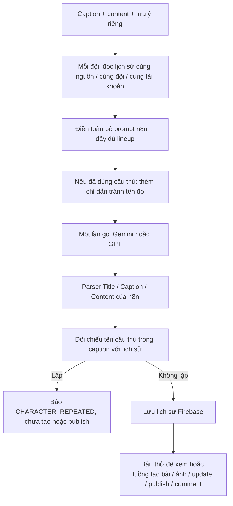

# Prompt n8n và lịch sử tránh lặp cầu thủ

Phiên bản: `n8n-rotation-v5`. Luồng này thay `n8n-context-v4`.

## Những gì được giữ

`config/rewrite-prompt.md` vẫn là toàn bộ prompt node `g1_new1` của nhánh `start` trong workflow. Không sửa rule, không cắt nguồn thành bản tóm tắt, không ghép context-writer-policy và không gọi Analyzer. Model tự chọn nhân vật theo prompt gốc. Lượt đầu chưa có lịch sử nhận đúng prompt đã điền biến, cộng lưu ý riêng nếu có. Lượt sau loại các cầu thủ đã dùng khỏi players, personnel và captain trước khi điền prompt; chỉ danh sách còn lại được dùng làm nguồn chọn cầu thủ. Bổ sung ràng buộc không khôi phục người bị loại từ trí nhớ hay nội dung nguồn; không yêu cầu xác minh sự kiện hay khái quát hóa số liệu.

Một lần gọi writer cho mỗi đội, không giới hạn tổng số đội. Không tự đổi provider hoặc thêm lần gọi sửa bài. Các thao tác HTTP Tinfos/Trello, cập nhật rồi publish, cardId lấy từ kết quả publish vẫn giữ như trước.

## Lịch sử

`users/{uid}/characterRotation/{sha256}`. Hash gồm caption, content, đội, môn thể thao; chuẩn hóa Unicode, chữ thường và khoảng trắng. Hai nội dung khác nhau có lịch sử riêng. Không lưu nguyên văn nguồn trong lịch sử này. Prompt hoặc note thay đổi nhưng cùng nguồn và đội vẫn dùng chung lịch sử.

Tên được nhận diện bằng đối chiếu nguyên tên có ranh giới từ với `players` và hồ sơ `personnel` có role player. Chỉ caption được dùng để ghi nhận: nhắc một người trong phần so sánh ở thân bài không tiêu thụ lượt. Không tự suy đoán tên chưa có trong dữ liệu. Vì vậy cựu cầu thủ từ kiến thức model nhưng không có trong hồ sơ, bí danh hoặc tên viết tắt không khớp chưa được bảo đảm chống lặp. HLV không bị thay chỉ để tạo sự khác biệt.

Bản viết thử cũng tiêu thụ lượt khi viết thành công, kể cả khi chưa publish hoặc publish sau đó lỗi. Nếu model lặp lại tên bị loại, trả 422, không lưu lượt và không tạo draft. Nếu không có tên nhận diện được, trả kết quả với ghi chú rõ ràng, không tạo lịch sử đoán mò. Khi số cầu thủ đã dùng vượt 75% danh sách đã biết, lượt viết tiếp theo bắt đầu vòng mới với đầy đủ lineup; đúng 75% chưa reset. Ví dụ danh sách 20 người reset sau khi đã dùng 16 người; không hứa luân phiên qua những người không phù hợp với rule gốc.

Firestore transaction giữ lease 10 phút cho cùng nguồn và đội, chống hai request đồng thời dùng cùng lịch sử; lỗi viết trả lease, không tiêu thụ cầu thủ. Dữ liệu vẫn còn qua lần khởi động Vercel. Chưa có API xóa lịch sử thủ công. API public không có workspace scope dùng scope public, còn workspace dùng UID riêng.

## Prompt và FE

FE chỉ còn editor `rewrite`; kết quả hiển thị các tên nhận diện, danh sách đã tránh và vòng hiện tại. Khi phiên bản này chạy, đọc prompt sẽ sao lưu document cũ ở `settings/prompts/versions/before-n8n-rotation-v5-rN`, giữ nguyên rewrite đã lưu và bỏ contextAnalysis khỏi cấu hình hoạt động. Không ghi đè chỉnh sửa prompt của người dùng.

## Kiểm chứng

- 155 kiểm tra backend đạt, gồm tính độc lập nguồn/đội/tài khoản, lưu qua service mới, hết vòng, lỗi writer, chống lặp, lease và API workflow.
- Backend/frontend build, frontend lint đạt.
- Test thực Gemini cùng nguồn / Adelaide Crows: lượt 1 Izak Rankine, lượt 2 Josh Rachele; 2 lượt viết, 2 lần gọi model, 0 publish. Chi tiết: `test-results/rotation-live.json`.
- Khi deploy bản v5, lần đọc prompt đầu tiên sẽ chuyển cấu hình sang phiên bản mới và lưu bản sao cấu hình cũ. Lịch sử của hai bản test thật đã lưu Firebase.

## Caption nhiều dòng (bản sửa 2026-10-29)

Bộ tách `format-content.ts` đọc toàn bộ vùng từ `Caption:` đến nhãn `Content:` ở đầu dòng, thay cho regex cũ chỉ lấy dòng đầu. Giữ xuống dòng, đoạn diễn giải, tên nhân vật và CTA; từ `Content:` nằm giữa câu không bị hiểu thành nhãn. Nếu model không ghi nhãn Content, dùng thẻ HTML block đầu tiên làm ranh giới. Giữ nguyên toàn bộ HTML sau ranh giới, không viết lại nội dung. Caption thiếu/rỗng hoặc body thiếu vẫn bị chặn theo quy trình hiện tại.

Đây là bản sửa parser so với bản port format5 trước đó, không sửa các rule prompt n8n hay body/header API. Đồng thời cơ chế chống lặp đã đọc được tên cầu thủ ở các dòng sau của caption. Kiểm tra hồi quy gồm mẫu SHOCKWAVE, LF/CRLF, CTA, HTML nhiều đoạn, nhãn lẫn trong câu, caption rỗng, truyền caption đầy đủ vào Trello và nhận diện tên ở đoạn sau.
